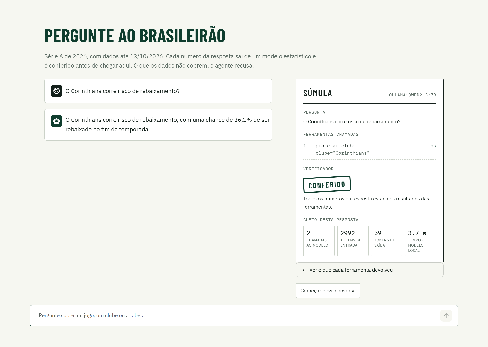
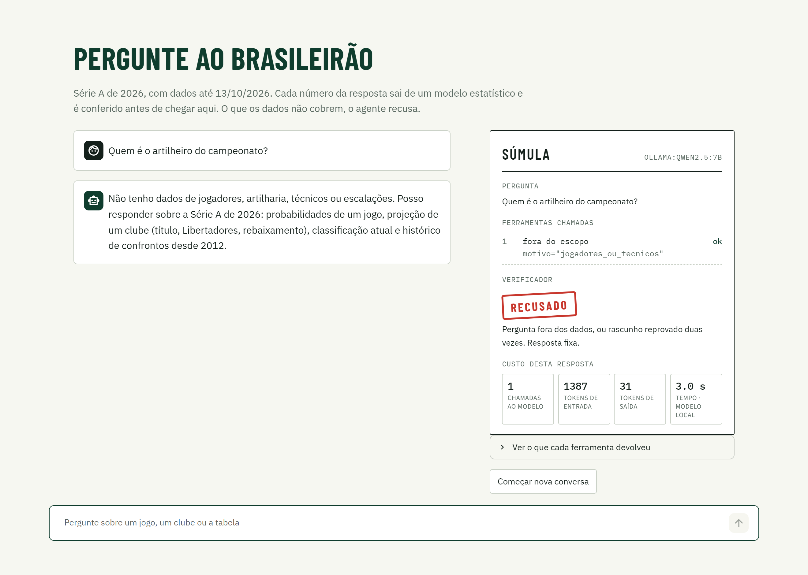

# Pergunte ao Brasileirao

[](https://github.com/Joaogmos/pergunte-ao-brasileirao/actions/workflows/ci.yml)

Agente LLM que responde em portugues perguntas sobre a Serie A do Campeonato Brasileiro.
Os numeros saem de um modelo estatistico (Dixon-Coles + Monte Carlo) exposto como
ferramentas; o LLM escolhe a ferramenta e escreve a resposta, e um verificador em codigo
confere se cada numero do texto veio mesmo de uma ferramenta. O que os dados nao cobrem,
o agente recusa.

No conjunto de teste, com um modelo aberto de 7B rodando numa GPU de 8 GB, o agente
acerta 18 de 20 perguntas. As duas que erra estao descritas na secao 3.



---

## 1. O problema

Um LLM responde "qual a chance de o Santos cair?" com um numero plausivel e inventado.
Eu ja tinha o numero certo: o [brasileirao-em-numeros](https://github.com/Joaogmos/brasileirao-em-numeros)
ajusta um Dixon-Coles em 5.618 jogos e simula o resto da temporada 20 mil vezes. Faltava
a interface em linguagem natural, e ela so serve se:

- o modelo de linguagem nunca for a fonte de um numero;
- der para provar isso com um eval, e nao com meia duzia de perguntas feitas a mao;
- a pergunta sem resposta nos dados (artilheiro, tecnico, Copa do Brasil) for recusada.

## 2. A solucao

| Parte | O que faz | Onde |
|---|---|---|
| Dominio | Carrega o snapshot, ajusta o modelo, simula a temporada e responde 5 consultas com o numero ja formatado | `servico.py`, [ADR-1](docs/adr/adr-1-modelo-como-dependencia-travada.md), [ADR-2](docs/adr/adr-2-ferramenta-entrega-numero-pronto.md) |
| Ferramentas | 5 consultas + `fora_do_escopo`, com schema gerado dos tipos Python (tool calling) | `ferramentas.py`, `clubes.py` |
| Agente | Grafo de estados em LangGraph: modelo, ferramentas, verificador, recusa; memoria por conversa | `agente.py`, [ADR-4](docs/adr/adr-4-grafo-explicito-em-langgraph.md) |
| Guardrail | Verificador deterministico: numero sem fonte volta ao modelo uma vez e depois vira recusa fixa | `verificador.py`, [ADR-3](docs/adr/adr-3-verificador-deterministico.md) |
| Eval | 50 casos (30 dev + 20 teste), juiz em codigo, gabarito calculado na hora | `evals/`, `avaliacao/`, [ADR-5](docs/adr/adr-5-juiz-deterministico-e-conjunto-de-teste.md) |
| Entrega | API FastAPI, painel Streamlit, Docker Compose, CI que re-julga o eval | `api.py`, `app/`, [ADR-7](docs/adr/adr-7-eval-gravado-no-ci.md) |

O grafo:

```
 pergunta
    |
    v
 [modelo] --pediu ferramenta--> [ferramentas] --resultados--> [modelo]
    |                                 |
    | respondeu em texto              | chamou fora_do_escopo
    v                                 v
 [verificador] --reprovou 2x-----> [recusa] --> fim
    |      \
    |       reprovou 1x: o rascunho volta ao [modelo] com o motivo
    v
   fim
```

A resposta final passou no verificador (houve chamada de ferramenta no turno e todo
numero tem fonte) ou e a mensagem fixa de recusa. O verificador e uma funcao pura:

```python
def verificar(resposta: str, fatos: list, perguntas: list[str]) -> Verificacao:
    fontes = numeros_dos_fatos(fatos) + [n.valor for p in perguntas for n in extrair_numeros(p)]
    sem_fonte = [n.texto for n in extrair_numeros(resposta) if not _tem_fonte(n, fontes)]
    return Verificacao(aprovada=not sem_fonte, sem_fonte=sem_fonte)
```

O painel mostra, ao lado de cada resposta, a "sumula": ferramentas chamadas, argumentos,
veredito do verificador, tokens e tempo. A recusa aparece assim:



## 3. Os resultados

Todos os numeros abaixo saem de `evals/resultados/*.json` e estao em
[`evals/RESULTADOS.md`](evals/RESULTADOS.md), gerado por script. Execucao de 11/11/2026,
Ollama 0.40.16, RTX 4060 de 8 GB, Ryzen 7 5700X, temperatura 0 e semente fixa.

`dev` sao os 30 casos que usei para ajustar prompt e ferramentas. `teste` sao 20 casos
escritos antes dos ajustes e nunca usados para ajustar. O numero que vale e o do teste.

### Qualidade

| Modelo | Verificador | Teste | Dev | Ferramenta certa | Numero certo | Recusa certa |
|---|---|---|---|---|---|---|
| `qwen2.5:7b` | ligado | 18/20 (90%) | 30/30 (100%) | 100% | 97% | 91% |
| `qwen2.5:7b` | desligado | 18/20 (90%) | 30/30 (100%) | 100% | 97% | 91% |
| `llama3.2:3b` | ligado | 5/20 (25%) | 11/30 (37%) | 72% | 22% | 64% |

Os 100% no dev sao otimistas: cheguei neles depois de duas rodadas de ajuste olhando
para esses mesmos casos. No teste, que eu nao olhei, caiu para 90%. Com 20 casos, cada
erro vale 5 pontos percentuais.

As duas falhas do `qwen2.5:7b` no teste:

- "Quantos gols o Coritiba deve sofrer jogando fora contra o Athletico-PR?" Chamou a
  ferramenta certa e citou o campo errado: respondeu com os gols esperados do proprio
  Coritiba. O numero existe no resultado, entao o verificador aprovou.
- "Quem vai ganhar a Libertadores este ano?" Devia recusar (outra competicao).
  Respondeu com o ranking de quem deve se classificar para a Libertadores pelo
  Brasileirao, que e outra pergunta.

### Custo e latencia (media por pergunta, 50 casos)

| Modelo | Chamadas ao LLM | Tokens entrada | Tokens saida | Latencia mediana | Latencia p95 |
|---|---|---|---|---|---|
| `qwen2.5:7b` | 1,90 | 3008 | 80 | 1,62 s | 3,18 s |
| `llama3.2:3b` | 2,02 | 2357 | 47 | 0,76 s | 1,39 s |

O modelo de 3B responde na metade do tempo e erra tres em cada quatro perguntas do teste.
Ele chama a ferramenta certa em 72% dos casos e le o resultado errado: respondeu que o
Palmeiras tem 32 pontos (sao 63) e que "o artilheiro do Brasileirao e o Flamengo, com 64
pontos". Para esta tarefa, o modelo menor nao e uma economia.

A entrada domina o custo. O schema das 6 ferramentas e o prompt de sistema somam cerca
de 1.300 tokens e sao reenviados em cada chamada. Como rodei tudo local, nao ha custo em
dolar medido; o codigo calcula quando o modelo tem preco em `config.PRECOS_USD_POR_MTOK`.

### O que o verificador fez

Pouco, e isso tambem e resultado. Em 50 perguntas ao `qwen2.5:7b` ele reprovou 2
rascunhos, e os 2 terminaram em resposta correta. O caso que justifica a existencia dele:
com o verificador desligado, a pergunta "em que posicao o Vasco deve terminar?" saiu com
"20% de chance de terminar entre os primeiros seis colocados". A ferramenta dizia 0,2%.
Com o verificador ligado, o 20 foi apontado como numero sem fonte e a resposta corrigida
saiu sem ele.

O que ele nao pega esta nas duas tabelas acima. Ele confere de onde o numero veio, nao a
quem pertence: os 32 pontos do "Palmeiras" estavam na tabela, na linha de outro clube.
Por isso a nota do `llama3.2:3b` nao melhora com ele.

### Tres coisas que o eval achou

- Uma ferramenta que o runtime descartava em silencio. Com o nome `projecao_clube`,
  o Ollama devolvia resposta vazia para qualquer pergunta sobre rebaixamento. Renomeada
  para `projetar_clube`, funcionou. Nao investiguei a causa no parser
  ([ADR-6](docs/adr/adr-6-modelo-aberto-local-como-padrao.md)).
- Um parametro que induzia erro. `classificacao_atual(limite)` fazia o modelo pedir
  `limite=1` e concluir que o Palmeiras nao estava na tabela. Tirei o parametro.
- Dois erros do juiz. Li as falhas da primeira rodada uma a uma, e duas eram do juiz:
  ele nao aceitava "24 de maio de 2026" como 24/05/2026, e exigia recusa num caso de
  injecao em que responder com o dado real tambem esta certo. Corrigi e cobri com teste.

### Testes

62 testes (`pytest`, 2,5 s, sem LLM e sem rede). O grafo e testado com um modelo
roteirizado, que devolve as mensagens que o teste escreveu:

| Teste | Prova que... |
|---|---|
| `test_numero_inventado_e_devolvido_ao_modelo_e_a_correcao_e_aceita` | o rascunho com "35%" volta ao modelo com o numero apontado |
| `test_modelo_que_insiste_no_numero_inventado_termina_em_recusa_fixa` | na segunda reprovacao nada do texto do modelo chega ao usuario |
| `test_resposta_de_memoria_sem_ferramenta_e_barrada` | responder sem chamar ferramenta nao passa |
| `test_limite_de_chamadas_interrompe_loop_de_ferramentas` | o agente para na 6a chamada ao modelo |
| `test_mesma_conversa_lembra_do_turno_anterior_e_conversas_diferentes_nao` | a memoria e por `conversa_id` |
| `test_eval_gravado_bate_com_o_juiz_e_os_dados_atuais` | o resultado versionado ainda vale com o codigo atual |
| `test_projecao_repete_os_numeros_do_projeto_original` | os numeros sao os do repositorio do modelo |

## 4. Alternativas consideradas

| Abordagem | Por que nao |
|---|---|
| So o prompt dizendo "nao invente" | E uma instrucao, nao uma garantia. A ablacao mostra o caso que passa. |
| Segundo LLM como revisor | Uma chamada a mais em toda resposta e pode errar igual. Serviria para atribuicao, que a regex nao alcanca. |
| LLM-as-judge no eval | A resposta certa e um numero. Comparacao exata e mais barata e nao erra. |
| RAG sobre textos do campeonato | Os dados sao tabulares e o numero precisa ser exato. Busca vetorial traria texto parecido, nao o valor. |
| `create_react_agent` pronto | O verificador e a recusa fixa entrariam por ganchos e o fluxo sairia de vista. |
| Rodar o eval ao vivo no CI | Sem GPU, so caberia o modelo de 3B, que acerta 25%. |

## 5. Como rodar

Requisitos: Python 3.11+, git e [Ollama](https://ollama.com).

```bash
ollama pull qwen2.5:7b

python -m venv .venv && . .venv/Scripts/activate     # Linux/macOS: source .venv/bin/activate
pip install -e ".[dev,app]"

pytest                                       # 62 testes, nao precisa do Ollama
streamlit run app/streamlit_app.py           # painel em http://localhost:8501
uvicorn pergunte.api:app --reload            # API em http://localhost:8000/docs

python -m pergunte.avaliacao.executar                        # eval completo (~90 s na RTX 4060)
python -m pergunte.avaliacao.executar --conjunto dev         # so os casos de ajuste
python -m pergunte.avaliacao.executar --sem-verificador      # ablacao
python -m pergunte.avaliacao.executar --modelo ollama:llama3.2:3b
python -m pergunte.avaliacao.relatorio                       # regenera evals/RESULTADOS.md
```

Com Docker (a API no container, o Ollama na sua maquina):

```bash
docker compose up --build
curl "http://localhost:8000/dados/jogo?mandante=Santos&visitante=Palmeiras"
curl -X POST http://localhost:8000/perguntar -H "Content-Type: application/json" \
     -d '{"pergunta": "O Santos corre risco de cair?"}'
```

Para trocar de modelo, defina `PERGUNTE_MODELO` (ver `.env.example`). O provedor
Anthropic esta implementado (`pip install -e ".[anthropic]"`) e nao entrou no eval.

## 6. Arquitetura

```
data/BRA.csv + MANIFEST.json            mesmo snapshot do brasileirao-em-numeros (SHA-256 conferido)
        |
        v  servico.py                   Dixon-Coles + 20 mil simulacoes, uma vez na subida
   5 consultas com numero formatado     (pacote `brasileirao`, travado em commit)
        |
        +--> api.py  /dados/...         as mesmas consultas por HTTP, sem LLM
        |
        v  ferramentas.py               tool calling: schema a partir dos tipos Python
   agente.py (LangGraph)                modelo -> ferramentas -> verificador -> recusa
        |            ^
        |            +-- llm.py         ollama:<modelo> ou anthropic:<modelo>
        |
        +--> api.py  /perguntar         resposta + trilha de auditoria
        +--> app/streamlit_app.py       conversa + sumula
        +--> avaliacao/executar.py      evals/casos.json -> evals/resultados/*.json
                    |
                    v  juiz.py          tipo, ferramenta, numero, texto
             relatorio.py -> evals/RESULTADOS.md      tests/test_juiz_e_eval.py (CI)
```

Stack: Python 3.13 · LangGraph · LangChain (tool calling) · Ollama (qwen2.5, llama3.2) ·
FastAPI · Pydantic · Streamlit · pytest · ruff · Docker Compose · GitHub Actions.

## 7. Limitacoes e melhorias planejadas

- O verificador confere origem, nao atribuicao. Numero certo no clube errado passa.
  O proximo passo e saida estruturada: o modelo devolve referencias aos campos do
  resultado e o codigo monta a frase.
- Mudanca de prompt nao e pega pelo CI. O CI re-julga respostas gravadas. Quem mexe
  no prompt precisa rodar o eval ao vivo e versionar o resultado. A correcao e um job
  com API paga e limite de gasto, so em PR que toque `agente.py` ou `ferramentas.py`.
- 50 casos, todos escritos por mim. Falta pergunta de usuario real e falta volume
  para a diferenca entre 90% e 95% significar alguma coisa.
- Observabilidade minima. Com `PERGUNTE_TRACE=arquivo.jsonl`, cada pergunta vira uma
  linha JSON com as ferramentas chamadas, o veredito do verificador, tokens e latencia.
  Nao ha tracing por etapa do grafo (Langfuse ou OpenTelemetry).
- Memoria em processo. O checkpointer e em memoria, entao reiniciar a API apaga as
  conversas. O modelo recebe so as ultimas 6 perguntas de cada conversa (com as chamadas
  de ferramenta delas); o que ficou para tras e cortado, sem resumo.
- Custo em API nao medido. Faltou rodar o mesmo eval num modelo pago para ter a
  tabela de custo por pergunta ao lado da de qualidade, e testar cache de prompt nos
  1.300 tokens que se repetem.

## 8. Uso de IA

Construido com o Claude Code. O escopo e meu: um agente sobre o modelo que eu ja tinha,
proibido de inventar numero e com eval que rode no CI. A implementacao, os testes, os
casos de avaliacao e a redacao dos ADRs e deste README foram gerados com IA a partir
disso.

O criterio continua o mesmo dos outros projetos: so considero pronto o que consigo
explicar em voz alta sem olhar.
